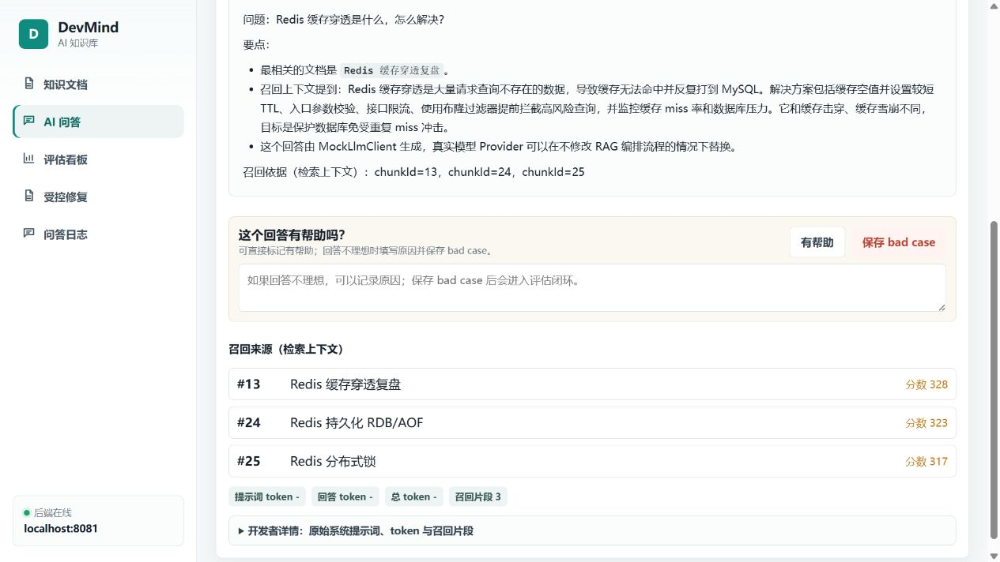
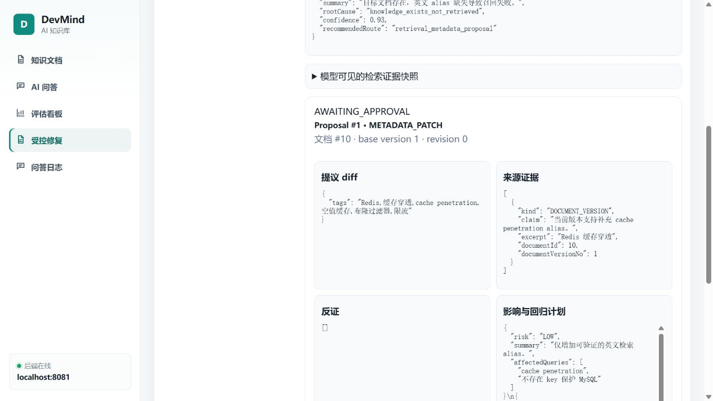
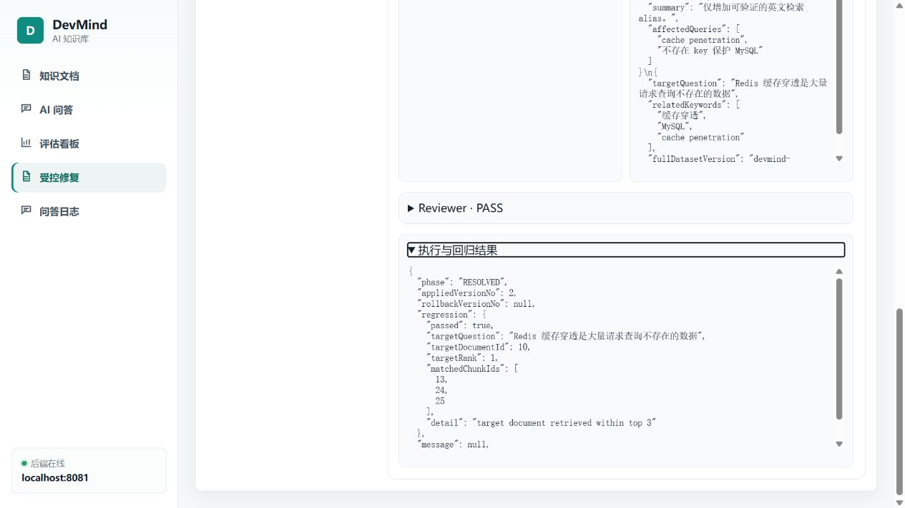

# DevMind · AI 知识库

[](https://github.com/wwjorker/devmind/actions/workflows/ci.yml)

DevMind 用来整理开发笔记和项目资料：导入文档后，可以围绕知识库提问、查看回答引用的原文，并通过反馈追踪回答问题。对于部分检索问题，系统支持提出修复建议，经人工审批后更新文档元数据、重建索引并复测。

项目采用 **Java 17 / Spring Boot 3、Vue 3 / TypeScript、MySQL 和 Redis**。默认使用本地 mock 回答与稀疏向量检索，无需模型 API Key；真实问答模型、dense embedding、rerank 和 pgvector 均需另行配置。

## 实际截图

以下为已有的本地运行截图，使用演示数据。问答使用 mock，修复提案使用预置离线样例；它们展示实际界面与执行流程，不代表实时模型生成效果。

### 问答与引用



回答旁展示来源文档、chunk ID 和召回分数，便于回到原文核对。

### 修复提案与证据



提案列出修改内容、来源版本、证据与回归问题；Reviewer 通过后仍需人工审批。

### 执行与复测



图中为预置提案实际执行后的结果：文档更新到 version 2，目标问题检索到该文档且排名为 1。操作步骤见[本地体验指南](docs/guides/local-demo.md)。

## 核心功能与关键设计

| 功能 | 实现与取舍 |
| --- | --- |
| 文档管理 | 支持创建、编辑、归档及 TXT / Markdown 导入；自动分块，保留不可变文档版本。 |
| 知识库问答 | 关键词 / FULLTEXT 与向量召回通过 RRF 融合；回答保留引用，检索为空时跳过模型并返回兜底。 |
| 问题追踪 | 记录 provider、耗时、token 用量和反馈；模型完整输入与日志中的有限 Prompt 预览分开。 |
| 受控修复 | Triage 调查、Reviewer 核验证据，Java 服务校验并执行人工批准的元数据修改；正文草稿只供审阅。 |
| 版本与恢复 | 使用乐观锁和幂等键；外部调用在数据库事务外，索引重建或目标回归失败时执行补偿回滚。 |
| 检索评估 | 用人工标注数据比较检索策略；MySQL 保存向量源数据，可选 pgvector 作为可重建的查询索引。 |

项目面向本地使用；功能边界见[当前限制](backend/docs/architecture.md#当前限制)，历史实验及结论见[评估说明](backend/evaluation/README.md)。

## 本地运行

准备 JDK 17+、Docker Desktop，以及 Node.js 20.19+（20.x）或 22.12+。以下命令用于 Windows PowerShell：

```powershell
git clone https://github.com/wwjorker/devmind.git
cd devmind
./start-local.ps1
```

脚本会启动 MySQL、Redis，并分别打开后端和前端终端。前端首次启动会安装 npm 依赖；后端使用 Maven Wrapper 构建。启动后访问 <http://127.0.0.1:5173>，先注册本地账号，再创建或导入文档。

默认端口为前端 `5173`、后端 `8081`、MySQL `3307`、Redis `6380`。没有覆盖环境变量时，问答使用 `mock`、embedding 使用 `local-sparse-vector`、rerank 为 `none`、向量存储为 `mysql-json`，不调用外部模型。脚本会继承已有环境变量；若曾配置真实 provider，请先核对[后端配置](backend/README.md#模型与检索配置)。

日常开发也可以用 IDEA 打开 `backend`，启动 Compose 依赖后选择共享配置 `DevMind - Local Mock`；前端在 `frontend` 中执行 `npm ci`、`npm run dev`。分步操作见[后端说明](backend/README.md#本地运行)和[前端说明](frontend/README.md)。

## 必要文档入口

- [本地体验指南](docs/guides/local-demo.md)：导入示例、准备演示数据、查看提案和执行结果。
- [后端运行与配置](backend/README.md) · [前端运行与构建](frontend/README.md)
- [架构与设计取舍](backend/docs/architecture.md) · [API 请求示例](backend/docs/api/devmind-api.http)
- [实验方法与结果](backend/evaluation/README.md)：检索对比、受控修复与独立 Reviewer 的验证边界。
- [部署与维护说明](docs/operations/production-readiness.md)
