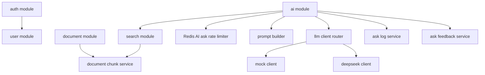
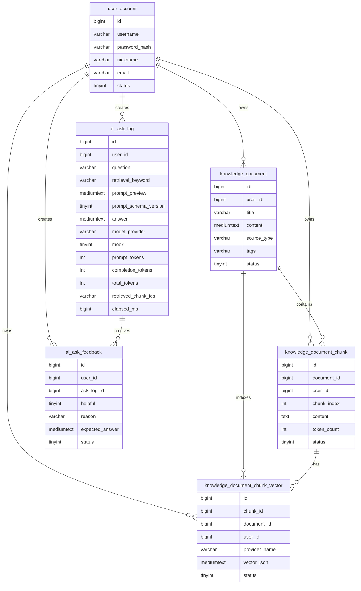
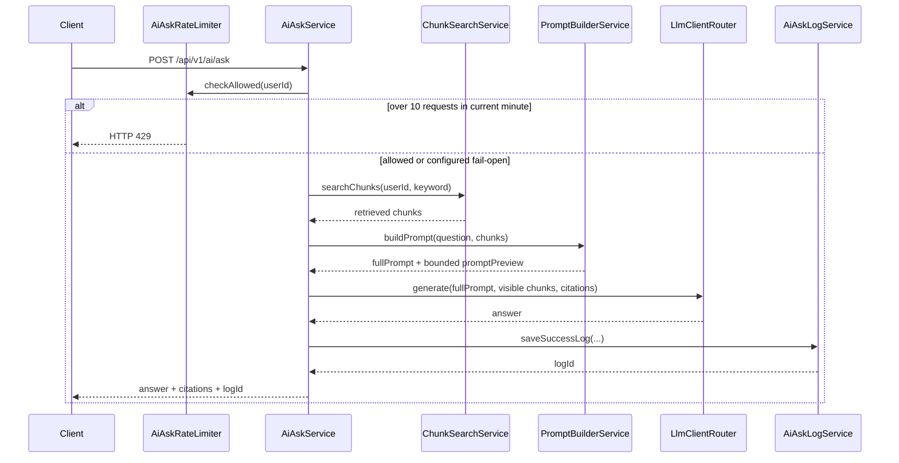

# DevMind 架构

## 目标

DevMind 是一个个人开发者知识库的 Java 后端项目。系统存储学习笔记和项目复盘，把长文档切成 chunk，检索相关 chunk，构造 RAG Prompt，并通过可插拔的 LLM client 路由最终的答案生成。

## 模块总览



## 数据模型

下图展示基础问答表；文档版本、Agent 审计、bad case 和提案表见后文“受控修复与恢复”。



## RAG 流程



## 设计取舍

- 文档和 chunk 用软归档而非物理删除，保留历史。
- 文档更新后重建 chunk，保证检索结果和最新内容对齐。
- 检索用 `RetrievalStrategy`、`EmbeddingClient`、`RerankClient` 三层抽象，复用检索实现；rerank 目前只用于离线评估，不进入在线问答。
- `EmbeddingClient` 把向量表示和检索编排分离：本地确定性稀疏向量（默认、零外部成本）和可选的真实 dense embedding（OpenAI 兼容 API）按 `provider_name` 共存于同一张向量表，可由配置切换。
- `RerankClient` 隔离 rerank 供应商（默认 `none`，可选外部 `/rerank` API），用于离线五方评估中的精排策略。
- chunk 向量行随文档 chunk 一起重建，存入 `knowledge_document_chunk_vector`。问答路径只构造 query 向量，再与已持久化的 chunk 向量比较，而不是每次提问都重算全部 chunk 向量。
- chunk 内容的 FULLTEXT 索引使用 ngram parser，让中文查询直接走 FULLTEXT 相关性排序；SQL 侧只做宽候选池截断（LIKE 兜底按更新时间截取），真正的相关性打分在服务层完成。
- 向量通道默认对持久化向量做暴力余弦，扫描上限为固定常量；启用 pgvector 后 dense 向量的相似度查询改由 Postgres HNSW 索引承担，不再受该上限约束。
- 双库取舍：MySQL 始终是主数据的唯一事实来源，向量是可由源文本重建的派生数据。启用 pgvector 时 dense 向量双写（MySQL JSON 行为源，pg 为 serving 索引），pg 写入是 best-effort——失败只降低召回、绝不阻塞主流程，脏行在读取侧被主库校验兜底。backfill 会把已有 active dense JSON 直接重放到 pgvector，也会生成缺失或复活归档的 MySQL 向量行。
- pgvector 的 HNSW 索引对 vector 类型最多支持 2000 维，因此 dense embedding 通过 API 的 dimensions 参数请求 1024 维，启动时对超限维度 fail-fast。
- 混合检索用 RRF 融合关键词/FULLTEXT 排名和向量排名，避免直接相加不同量纲的分数。
- `LlmClient` 把模型供应商实现和 RAG 编排分离。
- AI 问答入口按登录用户做固定一分钟窗口限流。Redis Lua 将 `INCR` 与首次 `EXPIRE` 放在同一次原子执行中，避免并发下计数与 TTL 分离；默认阈值为 10 次/分钟，超限返回 HTTP 429。Redis 故障时可在 fail-open（可用性优先）和 fail-closed（保护能力优先）之间配置。
- 调用日志记录问题、检索关键词、chunk id、答案、provider、token 用量和耗时，供后续 bad case 分析。
- 反馈记录保存 helpful 标注、原因和期望答案，让 bad case 能沉淀成一个小型评估数据集。
- 评估汇总接口聚合反馈数、bad case 数、bad case 率和近期 bad case，用于 RAG 质量分析。
- Flyway 管理数据库 schema 版本，让本地初始化和后续迁移不依赖手动复制 SQL。


## 受控修复与恢复


V6 migration 新增 `agent_run` 与 `agent_step`，用于持久化实验臂、预算、
累计用量、有序模型/工具步骤和终态；V7 为工具步骤补充 Provider
`tool_call_id`，使返回消息和审计步骤可以稳定关联。当前开放受认证保护的
repair workflow API，但模型仍没有通用知识库写工具；只有 Java 白名单执行器能在
人工批准后应用 metadata patch。

步骤预留和完成分别使用短事务；外部模型调用在事务外执行。步数、模型调用
次数和调用前 deadline 会在请求发出前阻断；总 token 以 Provider 返回的
usage 记账，达到阈值后禁止下一次调用。工具调用同样占用总步数并受 deadline
与 token 阈值约束，但不占用模型调用次数。审计仅保存角色、工具名、字段名、
字符数等有界摘要，不保存完整 Prompt、模型输出、工具参数值或工具结果正文。

当前只注册三个租户隔离的只读工具：`searchKnowledge`、
`getChunkEvidence`、`getAskLogEvidence`。`userId` 与 `runId` 由服务端上下文
注入，不属于模型参数。普通检索只返回 active 数据；历史证据工具允许按已记录
ID 读取 archived chunk，但会明确声明它是当前数据库行的解析结果，不是不可变
历史快照。旧 Prompt Schema 日志会标记为不可用于“证据正确但回答错误”判定。
Triage 输出使用固定六类根因和一一对应的 route，并拒绝未知字段。

`EvidenceTriageAgent` 负责只读调查编排：首轮固定读取目标 ask log，
随后按模型请求执行只读工具，完整重建 assistant/tool 消息，最终对 diagnosis
做服务端证据引用校验。未执行的 tool-call ID、工具结果中不存在的记录 ID、
重复 call ID、目标 ask log 串线，以及使用旧 Prompt Schema 判定“正确证据但
回答错误”，都会使 run 明确失败。[六条开发样例](../evaluation/v2-development-bad-cases-v0.1.json)
用于 scripted 编排测试，只覆盖协议和控制流，不用于衡量真实模型准确率。
系统包含 bad-case intake、业务状态机和受控提案。
预注册的 6 次模型调用、12 次工具调用、24,000 token 和 120 秒限制均有独立
持久计数或终态检查；已完成但造成 token 越界的模型调用保留审计记录，同时 run
立即进入 `BUDGET_EXHAUSTED`，不能再被标为成功。

知识写入以 `knowledge_document.version_no` 作为乐观锁，并在
`knowledge_document_version` 保存创建、导入、用户更新、归档和恢复后的不可变
全文及 metadata 快照。V9 会为已有文档补一条 version 1 baseline。文档当前态、
版本快照、chunk 替换和 MySQL 向量失效保持同一短事务；embedding 与 pgvector
同步仍在提交后执行。repair proposal 的来源证据绑定同一版本表。

新的 ask log 会额外保存结构化 retrieval snapshot：内容是模型实际可见的
有界 chunk 文本，并带当时的 document version。`helpful=false` 与问答快照
在同一短事务内生成去重的 `ai_bad_case`；旧日志缺少该快照时只保留
空证据并沿用原 prompt schema 标记，不伪装成新 schema 证据。bad case 状态
迁移受 Java 白名单和 `status_version` 乐观锁双重保护。

`repair_proposal` 把 diff、document base version、正反证据、影响范围和回归计划
分字段留痕。确定性 `ProposalValidator` 会拒绝跨租户引用、过期 base version、
越界 diff 和不存在于来源版本的 excerpt。首版只把 `METADATA_PATCH`
标记为可执行；`DOCUMENT_DRAFT` 必须引用 `USER_SUPPLIED` 可信材料，且只供
人工复核，不会被自动发布。proposal 创建使用租户级幂等键。

`ChangeReviewerAgent` 是独立的第二角色：它只读结构化 diagnosis、proposal、
当前 document version 和只读工具结果，首轮必须自主搜索当前用户知识库。
它不能读 ask log 工具、不能写入、不能审批；输出限定为 `PASS / REVISE /
REJECT` 严格 schema。`REVISE` 只能消耗一次幂等修订，第二次仍要求修订时
确定性终止为拒绝，避免 Agent 循环。

Reviewer `PASS` 只会把 proposal 送到 `AWAITING_APPROVAL`，不等于用户同意。
HITL 内部契约支持 `APPROVE / APPROVE_WITH_EDIT / REJECT`；人工编辑后的 diff
必须重新通过同一套租户、证据、字段白名单和 base-version 校验。审批请求
使用租户级幂等键；拒绝必须记录原因。review-only `DOCUMENT_DRAFT` 不能进入
执行状态。

受控执行把文档 metadata patch、版本快照、chunk 和 MySQL 向量源数据写入保持在
短事务中；随后才在事务外重建 embedding/pgvector serving index 并执行目标问题
Hit@3 回归。目标回归或派生索引失败时，执行器按变更前版本补偿 MySQL 源数据，
再重建 serving index；中断恢复使用幂等执行键继续未完成的执行或补偿。Triage
诊断、proposal/route 与 AgentRun 成功事实同事务提交，Reviewer 决策与对应
AgentRun 也同事务提交，但所有远程模型调用始终处于事务外。

前端“受控修复”页与 `/api/v1/ai/repair/**` 提供 case 列表、诊断、proposal diff、
正反证据、Reviewer findings、人工决定和执行结果。所有查询与动作都从认证主体
注入 `userId`，请求不能指定其他租户。当前公开动作接口均要求客户端幂等键：

```text
GET  /api/v1/ai/repair/cases
GET  /api/v1/ai/repair/cases/{badCaseId}
POST /api/v1/ai/repair/cases/{badCaseId}/triage
POST /api/v1/ai/repair/proposals/{proposalId}/review
POST /api/v1/ai/repair/proposals/{proposalId}/decision
POST /api/v1/ai/repair/proposals/{proposalId}/execute
```


## 当前限制

- 无上下文判定依赖“召回为空”，弱相关噪声可能进入 Prompt；尚未接入 dense 阈值判定。
- rerank 仅用于离线评估；PDF / Word / OCR 导入和 SSE 流式回答尚未实现。
- HNSW 参数目前使用默认值；[历史规模基准](../evaluation/retrieval-results.md)仅作单机参考。
- 自动执行仅覆盖白名单元数据修改，正文草稿和来源冲突仍需人工处理。
- 独立 Reviewer 的历史离线实验未达到预注册质量提升门槛，不能据此宣称优于简单模型方案，见[评估说明](../evaluation/README.md)。
